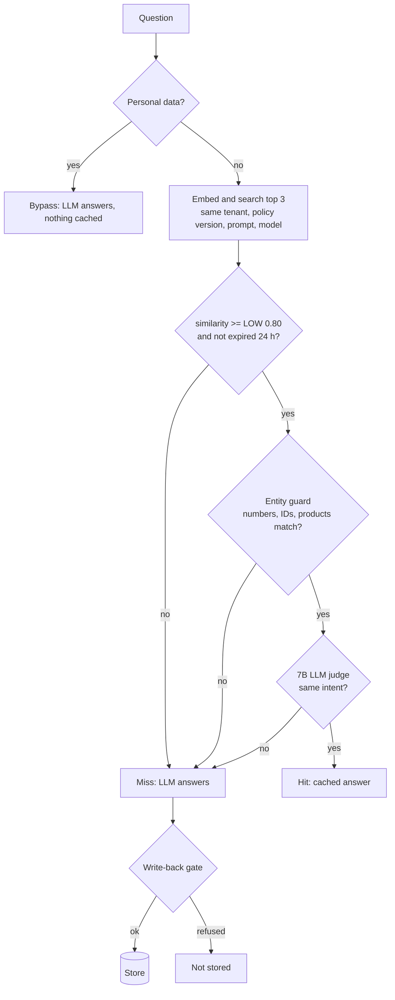
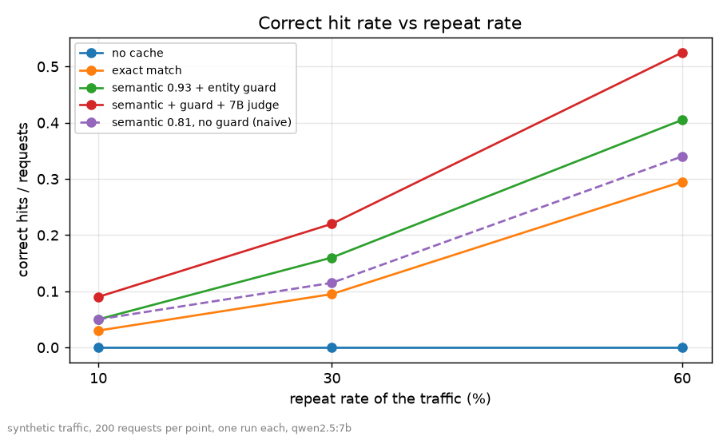
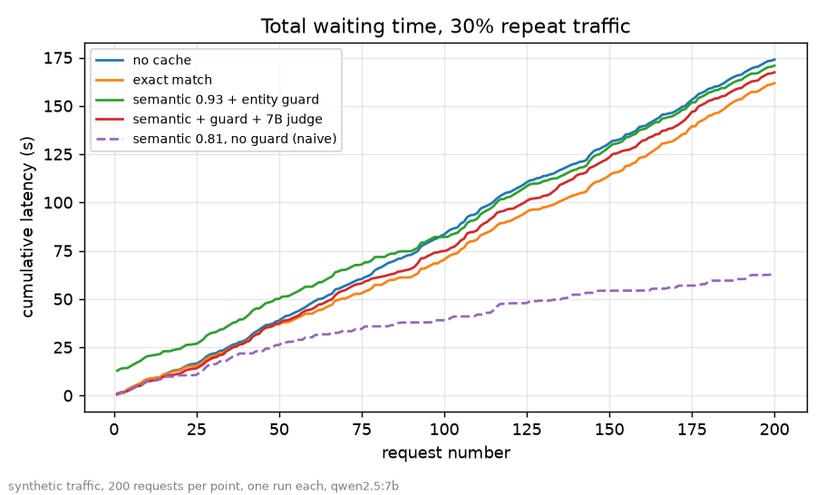

<div align="center">

# Honest Semantic Cache

[](https://github.com/pranjulya/03-semantic-cache/actions/workflows/tests.yml)

**A local semantic cache for an LLM support assistant, evaluated on whether it serves wrong answers, not just how fast it is.**

Python 3.11+ · FastAPI · Chroma · Ollama · 100% local at run time · 342 tests · MIT license

</div>

---

## Why this project exists

A semantic cache reuses an answer when a new question *looks like* an old one. The risk is a **false hit**: "free shipping
on a $60 order" answered from "$76", or the Pack 40L answered from the Pack 65L. This project builds a cache that treats
those errors as the main metric, and measures where it pays off and where it does not.

> **Core lesson:** a cache is a precision-versus-recall decision, and its savings depend on your traffic.

It answers questions about a fixed, fictional store policy (`data/policy.md`) with a local LLM. Savings are reported as
latency and LLM seconds, never dollars, because the model runs on your machine.

## How it works



| Stage | What it does | Why |
|---|---|---|
| Personal gate | Order numbers, emails, phone or card digits, "my order/account" skip the cache | An answer must be identical for every user to be cacheable |
| Thresholds | HIGH 0.93, LOW 0.80, chosen on a calibration split and reported on a held-out one | Avoids tuning on the data you report |
| Entity guard | Numbers, prices, IDs, dates, products must match | Embeddings barely register "$60" vs "$76" |
| Verifier | 7B LLM judge on the gray zone (0.80 to 0.93) and on hits above 0.93 | Catches same-entity, different-intent pairs |
| Write-back gate | Refuses refusals, personal answers, injected instructions, long answers, ungrounded prices or durations | Stops a poisoned answer from being served to the next user |
| Invalidation | Bump `policy_version` (0 stale in testing); TTL 24 h; topic invalidation is best effort | Stale answers after a policy change are the other way a cache lies |

Every request is logged to SQLite (decision, similarity, latency, and why an answer was or was not stored).

## Results

200 requests per cell, one run each, synthetic traffic, `qwen2.5:7b`. Full table: [`report/report.md`](report/report.md).
A false hit is a hit whose cached question has a different intent than the asked one.

| Repeat rate | Configuration | Hits | False hits | Repeats served from cache | Wall time vs no cache |
|---|---|---|---|---|---|
| 10% | exact match | 6 | 0 | 30% | 11 s faster |
| 10% | semantic 0.81, no guard (naive) | 114 | **104** | 50% | 96 s faster, mostly wrong answers |
| 10% | guard + 7B judge | 18 | 0 | 85% | **21 s slower** |
| 30% | exact match | 19 | 0 | 32% | 12 s faster |
| 30% | guard + 7B judge | 44 | 0 | 73% | 7 s faster (of 174 s) |
| 60% | exact match | 59 | 0 | 49% | 32 s faster |
| 60% | guard + 7B judge | 105 | 0 | 87% | 37 s faster (of 176 s) |

<p align="center">
  
  
</p>

**Reading the numbers**

- The final cache serves more repeats than exact match at every rate, with no false hits in these runs.
- The judge call costs time. At low repeat rates the cache is **slower than no cache**; break-even is roughly 20 to 25% repeats here.
- A hit takes about 360 ms with the judge (about 20 ms without it) against roughly 850 ms for an LLM answer.
- **Staleness** (20 changed policy facts, 10 controls): no invalidation served 20 of 20 stale answers; bumping `policy_version` served 0; TTL expiry served 0; invalidating by topic still served 9 of 20.
- **Security** (5 personal and 5 poisoning questions): 10/10 handled with the gates on, 2/10 with them off.

## Quick start

Requires [uv](https://docs.astral.sh/uv/) and [Ollama](https://ollama.com/download), and network access once for setup.

```bash
ollama serve &                    # if not already running
scripts/setup.sh                  # dependencies, qwen2.5:7b, embedder download, test suite
uv run python -m scache.cli demo  # scripted walk-through, local only
uv run uvicorn scache.api:app     # serve the API on localhost
```

```bash
curl -s localhost:8000/ask -H 'content-type: application/json' \
  -d '{"question": "How many days do I have to return an unused item?"}'
```

| Endpoint | Purpose |
|---|---|
| `POST /ask` | Answer a question; returns the decision (`hit`, `miss`, `bypass_personal`, ...), similarity and latency |
| `POST /admin/invalidate` | Delete cached questions similar to a topic. Returns the deleted count and `guaranteed: false` |
| `GET /stats` | Hit rate, latency by decision, why answers were not stored, estimated LLM seconds avoided |

**8 GB machines:** run `export SCACHE_LLM_TAG=qwen2.5:3b` in the shell first, then the commands above. The variable
must stay set for `demo` and `uvicorn` too, otherwise they ask Ollama for the 7B model that setup did not pull. The 3B
model is not a useful judge (8 of 28 true paraphrases accepted, against 25 for the 7B), but `demo` and the API always
use the judge; an entity-guard-only cache is available only through `cli replay --mode semantic` without `--verifier`.

## Commands

```bash
uv run pytest -q -m "not smoke"       # 342 tests, no Ollama needed
uv run pytest -q -s -m smoke          # live: embedder + Ollama
uv run python -m scache.cli sweep      --pairs eval/pairs.jsonl
uv run python -m scache.cli verifiers  --kind judge
uv run python -m scache.cli replay     --traffic eval/traffic_30.jsonl --mode semantic --threshold 0.93 --verifier judge --verify-high
uv run python -m scache.cli security   # personal and poisoning checks
uv run python -m scache.cli report     # rebuild report/ from saved runs
```

Each command has `--help`. `make help` lists the shortcuts.

## One failure, in full

The first semantic cache used a single threshold of 0.81. On 10% repeat traffic it returned 114 hits and
**104 were wrong**: questions that differ only in a number or product. A restocking-fee question about the Pack 40L was
answered from the Pack 65L (similarity 0.97), "free shipping on a $60 order" from "$76", the Summit Tent 2P return
window from the 4P. It was also the fastest configuration in every chart, which is why hit rate and speed alone are
not evidence that a cache works.

The fix was four changes, not one: calibrate thresholds on one split and report on another, add an entity guard, add a
verifier for the gray zone, and test with near-miss pairs written to fool the cache. Smaller mistakes are recorded in
[`docs/DECISION_LOG.md`](docs/DECISION_LOG.md): a judge example that leaked an evaluation pair, a verdict parser that
missed "Same: YES" (those first replays were invalid and kept aside), and a test that wrote fake vectors into the real cache.

## Limitations

- **Small evaluation set.** Set A has 150 labelled pairs (50 paraphrases, 100 misses); the held-out split has 45. Zero false hits in 30 held-out miss pairs only bounds the true rate at 11.4% (95% upper bound). Treat "0 false hits" as weak evidence.
- **Written with the test data in view.** The guard, the personal and injection patterns and the judge examples were tuned while the evaluation questions were visible. Known gaps are strict `xfail` tests in `tests/test_entity.py` ("two" vs "three" promo codes, "Sat" vs "Sun").
- **Synthetic traffic, one run per cell.** Repeat rates are generated, not observed.
- **The judge is part of the cache.** Verdicts depend on model and prompt; rerun `cli verifiers` after changing either. It adds 200 to 400 ms on the request path.
- **Computed answers are never cached** (tax, loyalty points), by design.
- **Topic invalidation is best effort.** After a policy change bump `policy_version`; old entries stay in the store but are never served (no purge command).
- **TTL of 24 h is a judgment call**, not measured.
- **The LLM's prefix cache makes the no-cache baseline fast**, which understates savings on a cold model or a longer prompt.
- **Changing the embedder over an old `cache/`** fails with a vector-size error from Chroma; run `cli clear` first.
- **Demo-grade API.** One request at a time; no auth unless `SCACHE_ADMIN_TOKEN` is set; bind to localhost.

## Repository layout

```
src/scache/    pipeline: service, cache, entity guard, verifier, gates, api, report, cli
data/          synthetic store policy v1 and v2 (v2 changes 10 facts)
eval/          labelled sets (pairs, traffic 10/30/60, staleness, security, answers) and saved runs
docs/          PRD, HLD, LLD, evaluation plan, decision log
scripts/       setup, model download, eval-set generation
report/        generated tables and charts
AGENTS.md      rules for AI coding agents working in this repo (CLAUDE.md points to it)
tests/         342 tests; test_offline.py enforces "no network except local Ollama"
```

Design truth is [`docs/LLD.md`](docs/LLD.md). Every threshold and trade-off has a dated entry in
[`docs/DECISION_LOG.md`](docs/DECISION_LOG.md).

## License

[MIT](LICENSE).
