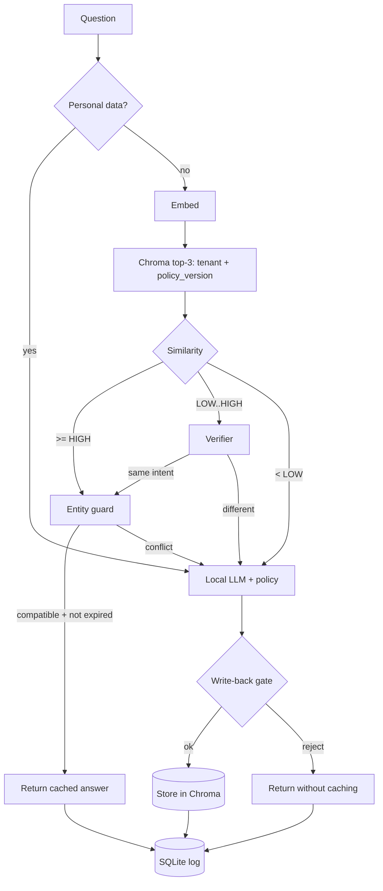

# HLD — Honest Semantic Cache (Project 03)

## Architecture

## Components
| Component | Why needed | Simpler option rejected and why |
|---|---|---|
| Exact-match dict (M2 baseline) | Shows what semantic adds | — kept as baseline |
| Local embedder | Paraphrase matching | Exact match only: low hit rate |
| Two thresholds | Separate "sure", "unsure", "no" | Single threshold: forces a bad trade |
| Verifier (cross-encoder or small LLM judge; chosen in M5) | Resolves gray zone | Verifier on every request: slower; measure |
| Entity guard (regex + rules) | Embeddings ignore "7 days" vs "30 days" | Trust similarity: near-miss false hits |
| Personal-data gate | Prevents cross-user leaks | Cache everything: privacy failure |
| Write-back gate | Prevents cache poisoning | Store every answer: one bad answer spreads |
| policy_version filter + TTL | Staleness | Manual clear only |
| SQLite log | Reproducible analysis | Print statements |

Rejected: LangGraph/agents (linear pipeline), RAG (policy fits in the prompt), Redis (Chroma is enough for one user).

## Model vs hardware
| Tier | LLM | Verifier |
|---|---|---|
| 8 GB | 1B–3B class | Cross-encoder (small) or off |
| 16 GB | 3B–8B class | Compare cross-encoder vs LLM judge |

## Failure modes
| Failure | Mitigation |
|---|---|
| Near-miss false hit (numbers differ) | Entity guard |
| Different intent, similar wording | Gray-zone verifier; held-out calibration |
| Stale answer after policy change | policy_version filter |
| Poisoned entry | Write-back gate; `invalidate_similar`; audit log |
| Cross-user leak | Personal gate; tenant filter |
| Embedder change makes old vectors invalid | Store embedder id; rebuild on mismatch |

## Scalability limits
Single process. Chroma local. Fine to ~100k entries (unverified; measure if it matters). No concurrency control.

## Technical debt accepted
No auth on /admin. Rule-based personal gate (misses some cases). Single tenant in demo.
