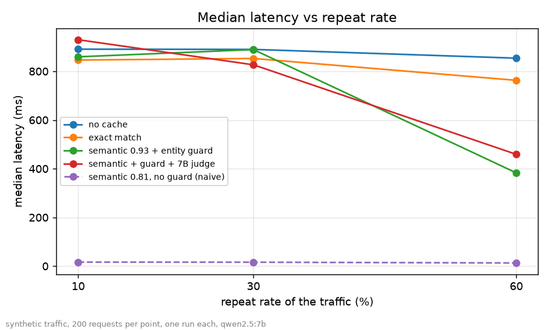
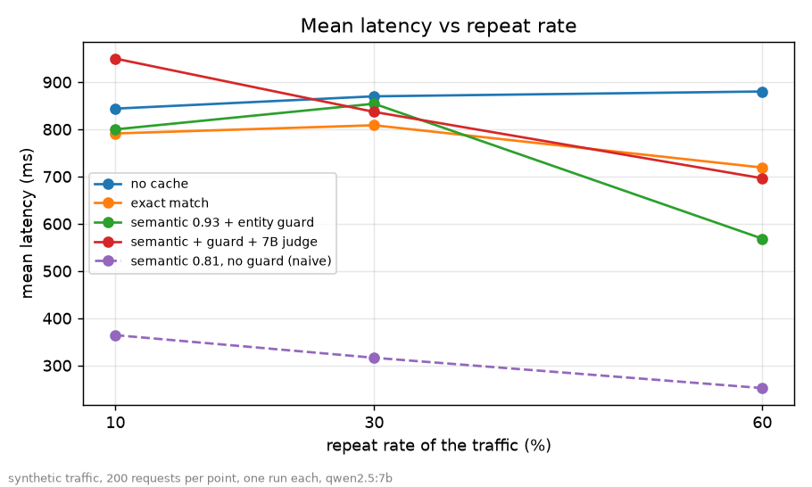

# Results

Generated from `eval/results`. synthetic traffic, 200 requests per point, one run each, qwen2.5:7b. Latency and LLM seconds, not money.

| repeat rate | configuration | hits | false hits | repeat recall | p50 ms | mean ms | LLM s | wall s | wall s vs no cache |
|---|---|---|---|---|---|---|---|---|---|
| 10% | no cache | 0 | 0 | - | 891 | 844 | 169 | 169 | +0 |
| 10% | exact match | 6 | 0 | 0.30 | 846 | 791 | 158 | 158 | +11 |
| 10% | semantic 0.93 + entity guard | 12 | 2 | 0.50 | 859 | 800 | 154 | 160 | +9 |
| 10% | semantic + guard + 7B judge | 18 | 0 | 0.85 | 930 | 950 | 155 | 190 | -21 |
| 10% | semantic 0.81, no guard (naive) | 114 | 104 | 0.50 | 16 | 364 | 68 | 73 | +96 |
| 30% | no cache | 0 | 0 | - | 890 | 870 | 174 | 174 | +0 |
| 30% | exact match | 19 | 0 | 0.32 | 853 | 809 | 162 | 162 | +12 |
| 30% | semantic 0.93 + entity guard | 32 | 0 | 0.53 | 889 | 854 | 163 | 171 | +3 |
| 30% | semantic + guard + 7B judge | 44 | 0 | 0.73 | 827 | 837 | 128 | 167 | +7 |
| 30% | semantic 0.81, no guard (naive) | 126 | 103 | 0.38 | 16 | 316 | 60 | 63 | +111 |
| 60% | no cache | 0 | 0 | - | 854 | 880 | 176 | 176 | +0 |
| 60% | exact match | 59 | 0 | 0.49 | 763 | 719 | 144 | 144 | +32 |
| 60% | semantic 0.93 + entity guard | 82 | 1 | 0.68 | 383 | 569 | 109 | 114 | +62 |
| 60% | semantic + guard + 7B judge | 105 | 0 | 0.87 | 459 | 696 | 86 | 139 | +37 |
| 60% | semantic 0.81, no guard (naive) | 147 | 79 | 0.57 | 13 | 252 | 47 | 50 | +126 |

Read the naive row with its false-hits column: its low latency comes mostly from serving wrong answers. A negative last column means the configuration was slower than no cache (the judge call costs time on every candidate; at 10% repeats it does not pay back).

